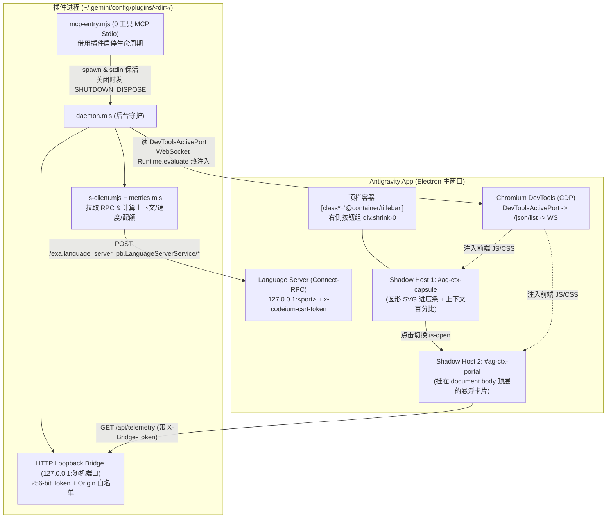

# Antigravity App 顶栏胶囊与悬浮卡片插件架构设计

> **说明**：本文档为前期架构与协议调研笔记（基于 `antigravity-usage-monitor` 源码拆解及截至 2026-11-26 的官方文档）。实际实现已进一步结合 `agy-context-dashboard` 思路，将本地 HTTP Loopback Bridge 简化为零端口 `Runtime.addBinding` 双向通道，并按精简规范裁剪了卡片字段（最新代码结构以根目录 `README.md` 与 `src/` 为准）。
>
> 本文档**仅面向 Antigravity App（桌面端 `v2.33.0+` ~ `v2.35.2`）**，不包含 Antigravity CLI (`agy`) 与 Antigravity IDE (VS Code 系) 的任何适配。

---

## 1. 目标需求与官方能力边界核实

### 1.1 目标交互形态
- **挂载位置**：Antigravity App 主窗口**右上角顶栏**（原生右侧按钮组左侧，紧邻 Toggle Overview / Aux Sidebar 等控制按钮）。
- **常驻胶囊形态**：**圆形 SVG 进度条 + 上下文占用百分比**（例如 `◔ 42%`），随对话推进实时刷新、按占用比例变色（正常 / 警告 / 危险），不打断阅读且支持自动跟随宿主深浅主题。
- **点击交互**：点击胶囊后向下展开一个**定位精准、信息丰富的悬浮卡片（Popover）**，集中展示当前会话的上下文拆解、生成速率、TTFT、Token/费用消耗、官方配额余量及最近调用/子代理动态（可选：鼠标悬停预览简卡）。

### 1.2 为什么不能走官方 MCP Apps / Sidecar？（官方最新文档核实）
核对官方 `v2.34.0`（MCP Apps 发布）与 `v2.35.2`（Latest）文档及 Changelog：

| 扩展机制 | 官方支持状态 | 可挂载位置 | 能否实现「右上角胶囊 + 悬浮卡片」 |
| :--- | :--- | :--- | :---: |
| **MCP Apps (`ui://`)** | 完整支持（`v2.34.0+`） | `inline`（对话流内）、`aux_pane`（右侧辅助栏 Tab）、`global`（左侧边栏全页）、`file`（文件查看器） | **不能**（无主窗口顶栏扩展点，也无法在页面顶层弹出独立悬浮卡片） |
| **Sidecar (`sidecar_sdk`)** | 仅后台脚本/定时任务公开；Web UI 属于内部能力 | `SIDECAR_UI_ENTRYPOINT_AUX_PANE`（右侧辅助栏） | **不能**（仅限右侧辅助栏 Tab，且默认需用户手动在 `config.json` 启用 `sidecars`） |
| **0 工具 MCP 保活 + CDP 注入** | 非官方扩展点（`usage-monitor` 实证方案） | **主窗口顶栏 `@container/titlebar` + `document.body` 顶层 Portal 悬浮窗** | **可以**（零修改 `app.asar`，随插件开关热挂载/热卸载） |

> [!IMPORTANT]
> **结论**：Antigravity App 截至 `v2.35.2` 仍未开放主窗口顶栏 UI API。要在不修改安装包 `app.asar` 的前提下实现「右上角胶囊 + 点击弹出悬浮卡片」，必须采用 **`temp/usage-monitor` 验证过的「0 工具 MCP Stdio 保活 + 本地回环 Bridge + CDP 动态挂载双 Shadow DOM」架构**。

---

## 2. `temp/usage-monitor` 核心实现原理拆解（纯 Agy App 视角）

去掉 `temp/usage-monitor` 中对 CLI、VS Code IDE、跨端迁移、多语言云端注入等冗余适配后，其面向 **Antigravity App** 的核心链路非常清晰，分为四层：



### 2.1 第一层：零上下文消耗的生命周期托管（`mcp-entry.mjs` -> `daemon`）
`usage-monitor` 发现了一个非常巧妙的宿主机制：
- **为什么不用 `sidecar.json` 作为主入口？**  
  官方 `sidecars.md` 规定 `sidecar` 进程需要在 `~/.gemini/config/config.json` 中显式配置 `sidecars.<id>.enabled = true` 才会启动；而插件里的 `mcp_config.json` 只要用户在 **Customizations → Installed** 打开插件开关，就会被宿主自动拉起。
- **0 工具 MCP Stdio 入口**：
  - 在 `mcp_config.json` 中声明 `"command": "node", "args": ["${PLUGIN_ROOT}/server/mcp-entry.mjs"]`。
  - `mcp-entry.mjs` 实现最简 JSON-RPC 2.0 协议（兼容行分隔与 `Content-Length` 帧）：`initialize`、`ping` 返回成功，**`tools/list` 返回 `{ tools: [] }`** —— **向大模型注入 0 个工具定义，消耗 0 个上下文 Token**。
  - 同时 `spawn` 真正干活的后台守护进程 `daemon.mjs`。
  - **优雅卸载闭环**：当用户在 App 里关闭插件开关或退出 App 时，宿主会关闭 `mcp-entry.mjs` 的 `stdin`；`mcp-entry.mjs` 向 `daemon` 写入 `SHUTDOWN_DISPOSE\n`，`daemon` 立即通过 CDP 在所有已注入窗口执行 `dispose()` 移除两个 Shadow Host，然后退出进程。

### 2.2 第二层：CDP 端口发现、目标过滤与热注入（`window-bridge.mjs`）
1. **定位调试端口文件 `DevToolsActivePort`**：
   - macOS：`~/Library/Application Support/Antigravity/DevToolsActivePort`
   - Windows：`%APPDATA%/Antigravity/DevToolsActivePort`（或 `LOCALAPPDATA`）
   - Linux：`~/.config/Antigravity/DevToolsActivePort`
   - 读取文件第一行获得纯数字 `cdpPort`。
2. **严格过滤 Antigravity App 主窗口目标**：
   - 请求 `http://127.0.0.1:<cdpPort>/json/list`。
   - **纯 App 过滤规则**（比原版精简掉 IDE `vscode-file://` 分支）：
     - `target.type === 'page'`
     - `target.url` 匹配 `^https://(127\.0\.0\.1|localhost|\[::1\]):\d+(?:\/|$)`
     - `target.webSocketDebuggerUrl` 匹配 `^ws://(127\.0\.0\.1|localhost|\[::1\]):\d+/`
   - 这样可以自动跳过内置浏览器页、DevTools 窗口或其他无关页面，同时天然支持**多开多个 Agy App 主窗口**。
3. **WebSocket `Runtime.evaluate` 热注入与保活**：
   - 每 `3000ms`（若启用 CDP RPC 兜底通道则 `1500ms`）向目标页面执行轻量探测表达式 `probeExpr`，检查 `window[OVERLAY_KEY].ensureAlive()` 与 `bundleVersion`。
   - 若页面刚打开、刷新或代码版本变更，则从磁盘读取构建好的 `styles.css` + `app.js` 并在注入时**预取首帧 `/api/telemetry`** 一并塞入 `window[BRIDGE_KEY]`，避免胶囊出现从 `--%` 闪烁一下的冷启动延迟。

### 2.3 第三层：分离式双 Shadow Host UI 架构（核心 UI 技巧）
`usage-monitor` 之所以在窗口切换会话、缩放、打开侧边栏时都不闪烁、不丢失弹窗状态，关键在于**把「顶栏胶囊」和「悬浮卡片」拆成两个独立的 Shadow Host**：

#### Host 1：顶栏胶囊（`#ag-ctx-capsule`）
1. **精准停靠在右上角（`resolveActiveDockTarget`）**：
   - 查找主窗口顶栏：`document.querySelector('[class*="@container/titlebar"]')`。
   - 查找右侧按钮组：`titlebar.querySelector(':scope > div.shrink-0') || titlebar.lastElementChild`（需校验 `rightGroup !== titlebar.firstElementChild`）。
   - 将 `capsuleHost` 通过 `insertBefore(..., targetContainer.firstChild)` 插入右侧按钮组最左侧，并设置 `data-dock="flow"`，使其成为原生顶栏按钮队列的一部分，自动随右栏开关左右平移，绝不遮挡原生按钮。
   - **兜底定位（`data-dock="fixed"`）**：若某些极窄或特殊视图暂时找不到 `@container/titlebar`，自动挂到 `document.body` 右上角 `position: fixed; top: 7px`，并通过 `findNativeTopRightAnchor()` 查找 `[data-testid="toggle-aux-sidebar"]` 计算 `right` 偏移避让。
2. **Electron 顶栏事件隔离**：
   - 顶栏默认带有 `-webkit-app-region: drag`，胶囊宿主必须显式设置 `-webkit-app-region: no-drag` 和 `pointer-events: auto`，并拦截 `mousedown` / `click` 冒泡。
3. **圆形 SVG 进度条 + 上下文百分比实现**：
   - 使用固定宽高比 SVG（`14×14`，`viewBox="0 0 14 14"`），通过 `transform: rotate(-90deg)` 让进度弧从 12 点钟方向顺时针绘制：
     ```html
     <svg viewBox="0 0 14 14" class="ctx-ring-svg" aria-hidden="true">
       <circle cx="7" cy="7" r="5.2" class="ctx-ring-track" />
       <circle cx="7" cy="7" r="5.2" class="ctx-ring-fill"
               stroke-dasharray="32.67" stroke-dashoffset="32.67" />
     </svg>
     <span class="ctx-pct">42%</span>
     ```
   - 周长 $C = 2 \pi \times 5.2 \approx 32.67$；占用率 $p \in [0, 100]$ 时，`stroke-dashoffset = +(32.67 * (1 - p / 100)).toFixed(2)`。
   - 阈值分段着色：`< 70%` 使用主题强调色、`70% ~ 87%` 使用 `tone-warn`、`>= 88%` 使用 `tone-danger`。
   - 文本启用 `font-variant-numeric: tabular-nums` 并为胶囊槽位预留定宽（如 `58px`），数字在 `9%` ↔ `100%` 变化时不引发顶栏文字左右抖动。
4. **保活防丢失**：
   - 通过 `MutationObserver`（监听 `document.body` 子节点变更）+ `1200ms` Watchdog 检查 `capsuleHost.isConnected` 和父容器归属；宿主路由切换重建顶栏 DOM 时自动在下一帧（`requestAnimationFrame`）重新停靠回右侧按钮组。

#### Host 2：Body 顶层浮层传送门（`#ag-ctx-portal`）
1. **为什么必须挂在 `document.body` 下？**
   - 宿主顶栏通常带有 `overflow: hidden` 或独立的低层级 Stacking Context（如 `z-0`）。若把悬浮卡片放在胶囊 DOM 内部，下拉卡片会被顶栏直接裁切；且顶栏在切换会话重建时会导致弹窗突然关闭、滚动条重置。
   - 将 `portalHost` 常驻于 `document.body` 末尾（`position: fixed; inset: 0; width: 0; height: 0; overflow: visible; pointer-events: none; z-index: 2147483000`），内部 `.popover-panel` 开启 `pointer-events: auto`。
2. **动态锚定与视口防溢出（`positionFloatingElements`）**：
   - 以胶囊 `capsuleBtn.getBoundingClientRect()` 为锚点：
     - `top = Math.max(38, Math.round(bRect.bottom + 6))`
     - `left` 默认右对齐胶囊右边沿（`rightAnchorEdge - panelW`），同时受限于左侧边栏右边沿（探测 `div[role="navigation"]` 的 `right + 12px`）和视口右边界（`vw - panelW - 12px`）。
     - `maxHeight = vh - top - 12`，自适应窗口高度。
   - 监听全局捕获阶段 `mousedown`（使用 `e.composedPath()` 判断点击是否落在 `popoverEl` 或 `capsuleHost` 之外）和 `Escape` 键自动收起。

### 2.4 第四层：本地回环 Bridge 与安全鉴权
主窗口运行在 `https://127.0.0.1:<appPort>`，后台守护进程起一个纯本地 `http://127.0.0.1:<randomPort>` 服务供浮窗拉取 `/api/telemetry`：
- **四重安全防线**：
  1. `Origin` 白名单：仅放行 `^https://(127\.0\.0\.1|localhost|\[::1\]):\d+$`；
  2. `Host` 头校验：必须是 `127.0.0.1:<port>` / `localhost:<port>` / `[::1]:<port>`；
  3. 256-bit 随机令牌：`X-Bridge-Token` 请求头 + `crypto.timingSafeEqual` 校验；
  4. Private Network CORS 头：`Access-Control-Allow-Private-Network: true`，避免 Chromium Private Network Access 拦截 `https` 页面访问 `http://127.0.0.1`。
- **CDP RPC 兜底通道**：若特殊网络策略拦截了 `fetch`，前端自动将请求压入 `window[BRIDGE_KEY].rpcQueue`，由后台 CDP 心跳轮询批量取出执行并在下一拍通过 `deliverRpc` 回传结果。

---

## 3. Agy App 2.33.0+ 的关键前提：`--remote-debugging-port=0`

> [!WARNING]
> **必须正面处理的运行时约束（已在 v2.35.2 本机实测确认）**：  
> 自 Antigravity App **v2.33.0** 起，官方修复了启动默认打开本地调试端口的行为，不再默认开启 `--remote-debugging-port=0`。本机运行中的 `Antigravity.app (2.35.2)` 默认状态下不存在 `~/Library/Application Support/Antigravity/DevToolsActivePort`。

如果不带 `--remote-debugging-port=0` 启动 Agy App，CDP 无法连接，顶栏胶囊就**无法注入**。`usage-monitor` 对此设计了两层无侵入恢复方案（`desktop-launcher-config.mjs`）：

1. **后台自动补齐启动入口（Windows / Linux）**：
   - **Windows**：纯 Node 扫描个人桌面、OneDrive 桌面、开始菜单、任务栏固定快捷方式（`.lnk`）以及 `HKCU\...\Run`、`antigravity://` 注册表项，无损追加 `--remote-debugging-port=0`。
   - **Linux**：自动修补 `~/.local/share/applications/antigravity.desktop` 与 `~/.config/autostart/antigravity.desktop` 的 `Exec=` 行。
   - **macOS**：因 `.app` 包有 Apple 代码签名，**严禁修改 `.app` 内容**，转而采用下面的「一键带参重拉」或外部启动命令。
2. **一键脱离父进程带参重拉（macOS / Windows / Linux）**：
   - 当检测到 `DevToolsActivePort` 缺失时，插件可提供重拉机制（或通过通知/附属 `aux_pane` 页面提供「一键启用顶栏胶囊并重启 Antigravity」按钮）：
   - macOS 执行脱离的子 shell：`osascript -e 'tell application "Antigravity" to quit'` 等待退出 → 清理陈旧 `DevToolsActivePort` → 执行 `open -a "/Applications/Antigravity.app" --args --remote-debugging-port=0`。

---

## 4. Antigravity App 数据采集与计算口径

只针对 **Antigravity App** 时，数据通道非常纯粹，无需读取 CLI 的 `~/.gemini/antigravity-cli/`，也无需解析 IDE 的 SQLite。

### 4.1 实时数据源：Language Server Connect-RPC
1. **自动发现端口与鉴权（`ls-discovery.mjs`）**：
   - 优先使用环境变量 `ANTIGRAVITY_LS_ADDRESS` 与 `ANTIGRAVITY_CSRF_TOKEN`；
   - 否则扫描 `~/.gemini/antigravity/daemon/hub_*.json`（按存活 `pid` 匹配），读取 `httpPort` / `httpsPort` 与 `csrfToken`；
   - 兜底通过 `ps` / `lsof` 查 `language_server` 端口并向 `GetUserStatus` 探活验证。
2. **SSH 远程窗口兼容（Agy App `v2.33.0+`）**：
   - 若用户打开的是 SSH Remote 窗口，本地 `hub_*.json` 不包含远端轨迹；此时 `window-bridge.mjs` 会通过 `window.__APP_CONFIG__` / `title` 中的 `[SSH: ...]` 识别远端窗口，并通过 CDP 在窗口内执行同源 `window.fetch` 或 `/connect-websocket`（`buildWindowRemoteRpcExpression`）代调远端 LS RPC，实现本地/远程窗口隔离监控。
3. **核心 RPC 接口**（`POST /exa.language_server_pb.LanguageServerService/<Method>`）：
   - `GetAllCascadeTrajectories`：获取全部会话列表、当前运行状态（`RUNNING` / `IDLE`）与最后修改时间；
   - `GetCascadeTrajectory`：拉取目标会话的 `steps[]` 与 `generatorMetadata[]`；
   - `GetUserStatus` & `GetAvailableModels`：获取账号计划、可用模型及默认上下文窗口上限；
   - `RetrieveUserQuotaSummary`：获取官方各模型池（如 Gemini / Argon / Carbon / Claude & GPT）的 5h 与每周配额余量及重置倒计时。

### 4.2 当前活跃会话定位（DOM 路由跟随）
为了保证右上角胶囊永远显示**用户当前正在看的这个对话**的上下文百分比：
1. 优先解析 `window.location.pathname` 中的 `/c/<uuid>`；
2. 若 URL 未体现，则从 DOM 读取可见且聚焦的 `[data-testid="conversation-view"][data-cascade-id]`，或与左侧选中的 `[data-testid^="conversation-row-"][data-selected="true"][data-cascade-id]` 取交集；
3. 若主对话启动了子代理 / Swarm Worker，在悬浮卡片内提供作用域切换器（主代理 / 单个子代理 / 全会话聚合）。

### 4.3 核心指标与上下文计算（源自 `trajectory-metrics.mjs`）
| 指标 | 来源字段与口径 | 关键避坑点 |
| :--- | :--- | :--- |
| **上下文总占比** | `chat.chatStartMetadata.contextWindowMetadata` | 优先取 `estimatedTokensUsed / maxContextTokens`（兜底 `(inputTokens + cacheReadTokens + outputTokens) / maxContextTokens`） |
| **10 通道上下文拆解** | `contextWindowMetadata.tokenBreakdown.groups` | 原生提供树状分布，映射为：**Assistant、Tool Results、User Input、Subagent、Checkpoint/压缩摘要、System Prompt、System Tools、MCP Tools、Skills、User Rules** |
| **生成速度 (TPS)** | `step.metadata` (`createdAt`, `finishedGeneratingAt` / `completedAt`) 与 `usage.outputTokens` | 1. 必须用 **`BigInt` 纳秒**做差算总耗时，防止 `Number` 浮点舍入误过 `0.5s` 阈值；<br>2. 过滤 `< 0.5s` 短请求，均速过滤压缩步与 `< 50` 输出 Token 步；<br>3. **绝不用 `streamingDuration` 作分母**（工具调用等待期间该值极小，会导致 TPS 严重虚高） |
| **首字延迟 (TTFT)** | `chat.timeToFirstToken` | 解析 Protobuf Duration（如 `"0.85s"`） |
| **Token & 缓存命中** | `usage.inputTokens`, `usage.cacheReadTokens`, `usage.outputTokens`, `plannerResponse.thinkingTokens` | `totalPrompt = input + cacheRead`<br>`cacheHitPct = cacheRead / totalPrompt`<br>`responseTokens = output - thinking` |

---

## 5. 宿主主题融合方案（纯 Agy App）

不兼容 VS Code 后，主题样式层可以彻底简化，**零硬编码颜色**：
1. **CSS 变量天然穿透 Shadow DOM**：Antigravity App 根节点 `<html>` 已挂有 `--background`、`--card`、`--foreground`、`--muted-foreground`、`--border`、`--primary`、`--font-sans`。
2. **极性同步**：用 `MutationObserver` 监听 `<html>` 与 `<body>` 的 `class` / `style` / `data-theme`，根据 `--background` 计算相对亮度，为 `capsuleHost` 和 `portalHost` 同步 `data-color-scheme="dark" | "light"`。
3. **语义化派生**：用 `color-mix(in srgb, ...)` 自动派生阴影、边框线、环形底轨与悬停高亮：
   ```css
   :host {
     --surface-bg: var(--background, #ffffff);
     --surface-panel: var(--card, var(--surface-bg));
     --text-primary: var(--foreground, #1e293b);
     --text-secondary: var(--muted-foreground, #64748b);
     --accent-primary: var(--primary, #2563eb);
     --border-hairline: color-mix(in srgb, var(--border, var(--text-primary)) 82%, var(--surface-panel));
     --surface-subtle: color-mix(in srgb, var(--surface-panel) 96%, var(--text-primary) 4%);
     --surface-track: color-mix(in srgb, var(--border-hairline) 42%, var(--surface-panel));
   }
   ```

---

## 6. 新插件极简架构设计（相比 `usage-monitor` 的精简定案）

如果只做 **Antigravity App 右上角「上下文环形进度条 + 百分比」胶囊 + 点击弹出信息丰富的悬浮卡片**，可以对 `temp/usage-monitor` 做大幅减法：

### 6.1 裁剪清单
- **去掉**：CLI (`statusLine`、`cli-sqlite-reader`)、Antigravity IDE (`.monaco-workbench`、`argv.json`、`extensionView` iframe 探测)、独立 Web Server (`standalone-server.mjs`)、Excel `.xlsx` 导出、跨端会话迁移、云端多语言实时翻译、Google 账号多开登录/切换器。
- **保留并聚焦**：
  1. **0 工具 MCP 保活入口**（无上下文消耗、插件开关即热启停）；
  2. **CDP 注入 + 双 Shadow Host**（右上角定宽防抖胶囊 + Body 顶层 Popover 悬浮卡片）；
  3. **纯 Connect-RPC 遥测引擎**（单/多窗口本地及 SSH 远端实时指标 + 10 通道上下文拆解 + 配额池 + 最近调用步）；
  4. **可选的 `aux_pane` MCP App 引导页**（仅当未检测到 `DevToolsActivePort` 时，用户也可在右侧栏看到诊断状态与「一键带参重启 Antigravity」引导，非强制）。

### 6.2 悬浮卡片（Popover）信息架构建议
点击右上角胶囊后，展开宽度约 `480px ~ 560px` 的单层细线悬浮卡片，建议按如下模块自上而下排布：

1. **Header 栏（会话与状态锚点）**：
   - 当前会话标题 + 会话快速切换下拉（默认跟随当前窗口路由）；
   - 运行状态徽标（`RUNNING` / `IDLE`）+ 当前模型名；
   - Scope 切换（主代理 / 某个子代理 / 聚合）+ 手动刷新按钮。
2. **上下文窗口深度拆解（Core Hero Card）**：
   - 大字号显示已用比例与精确 Token 量（如 `42.3% · 423.1k / 1.00M`）+ 同步的小号环形/分段条；
   - **10 通道构成条与胶囊图例**：按占用降序排列（Assistant / Tool Results / User Input / Subagent / Checkpoint / System Prompt / System Tools / MCP Tools / Skills / User Rules），鼠标悬停可看精确 Token 与百分比。
3. **实时性能 & 本会话 Token 消耗矩阵**：
   - 2×3 或 4 列紧凑指标卡：`最新速率 (tok/s)`、`会话均速 (avg tok/s)`、`首字延迟 (TTFT)`、`缓存命中率 (%)`、`输出拆分 (Thinking / Response)`、`累计输入 & 估算费用`。
4. **官方模型配额池（`RetrieveUserQuotaSummary`）**：
   - 展示当前各模型池（Gemini / Argon / Carbon / Claude & GPT 等）的 **5h 余量**与**周限额余量**进度条 + 重置倒计时。
5. **当前运行任务 & 最近调用步（可折叠 / Tab 切换）**：
   - 展示正在运行的子代理 / Swarm Worker 状态，以及本会话最近 N 次模型调用记录（序号、模型、TPS、TTFT、上下文增量），一眼定位上下文突增或慢请求元凶。

### 6.3 推荐项目目录结构
```text
~/.gemini/config/plugins/agy-context-hud/
├── plugin.json                    # 插件清单（name, displayName, version, description, logo）
├── mcp_config.json                # 声明 0 工具 stdio MCP 服务（node ${PLUGIN_ROOT}/server/mcp-entry.mjs）
├── assets/
│   └── logo.svg                   # 1:1 插件图标
└── src/
    ├── server/
    │   ├── mcp-entry.mjs          # 0 工具 MCP Stdio 宿主保活 + SHUTDOWN_DISPOSE 调度
    │   ├── daemon.mjs             # 后台主控（Bridge Server + CDP 轮询 + 文件热重载）
    │   ├── cdp-injector.mjs       # DevToolsActivePort 发现、纯 App 窗口过滤、WebSocket evaluate
    │   ├── launcher-relaunch.mjs  # Windows/Linux 快捷方式补参 + macOS 一键带参重拉
    │   ├── ls-discovery.mjs       # 扫描 ~/.gemini/antigravity/daemon/hub_*.json
    │   ├── ls-rpc.mjs             # Connect-RPC 客户端（本地直连 + SSH 窗口内同源转发）
    │   └── metrics.mjs            # TPS(BigInt 纳秒)、TTFT、10 通道上下文与配额聚合
    └── ui/
        ├── overlay.js             # 双 Shadow Host 挂载（#ag-ctx-capsule + #ag-ctx-portal）
        ├── capsule.js             # 圆形 SVG 进度条 + 百分比定宽胶囊组件
        ├── popover.js             # 悬浮卡片（上下文拆解、性能矩阵、配额池、近期调用记录）
        └── styles.css             # 宿主 CSS 变量桥接 + color-mix() 语义样式
```

### 6.4 实施里程碑
1. **Milestone 1（保活与 CDP 注入闭环）**：完成 `plugin.json`、`mcp_config.json`、`mcp-entry.mjs` 与 `cdp-injector.mjs`，在携带 `--remote-debugging-port=0` 启动的 Agy App 右上角 `@container/titlebar` 稳定挂载静态胶囊并随插件开关自动卸载。
2. **Milestone 2（实时上下文与胶囊联动）**：打通 `ls-discovery.mjs` + `ls-rpc.mjs` + 本地 HTTP Bridge，实现 DOM 路由跟随、圆形 SVG 进度条与上下文百分比实时更新及亮暗主题自适应。
3. **Milestone 3（丰富悬浮卡片与启动引导）**：完善 `popover.js`（10 通道上下文分布、TPS/TTFT、配额池、子代理/近期调用步），补全 `launcher-relaunch.mjs` 处理 `v2.33.0+` 无调试端口的一键带参重启流程。
